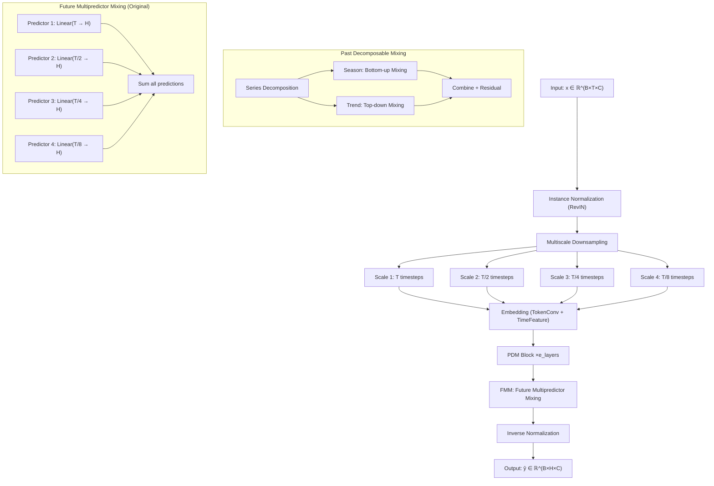
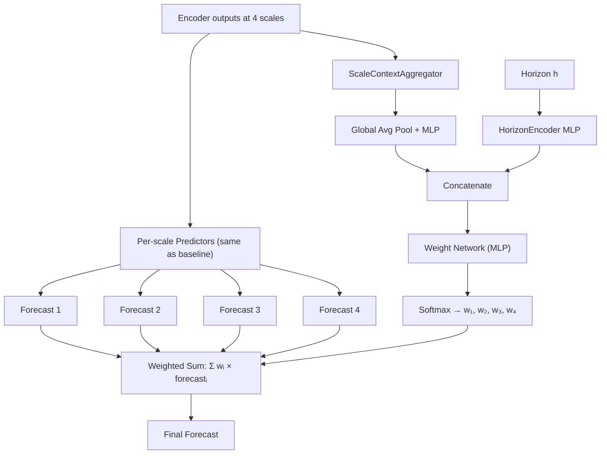

# TimeMixer Architecture Documentation

## 1. Original TimeMixer Architecture



## 2. Our Extension: Adaptive Multiscale FMM



## 3. Key Equations

### Original FMM
```
forecast = Σᵢ₌₁ᴷ fᵢ(PDM_output_scaleᵢ)
```

### Adaptive FMM (Ours)
```
context = Agg(enc₁, enc₂, ..., encₖ)     # Scale context aggregation
horizon_emb = HorizonEnc(pred_len)         # Horizon conditioning
weights = softmax(WeightNet(context ⊕ horizon_emb))   # Scale weights
forecast = Σᵢ₌₁ᴷ wᵢ · fᵢ(PDM_output_scaleᵢ)         # Weighted combination
```

### Ablation Variants
| Variant | Weight Computation |
|---------|-------------------|
| Full Adaptive | `w = softmax(MLP(context ⊕ horizon_emb))` |
| No Context | `w = softmax(MLP(horizon_emb))` |
| No Horizon | `w = softmax(MLP(context))` |
| Fixed | `w = softmax(learnable_params)` |

## 4. Parameter Overhead

The adaptive mixer adds:
- `ScaleContextAggregator`: K × d_model² + d_model × (K × d_model)
- `HorizonEncoder`: d_model/2 + d_model²/2
- `WeightNet`: ~3 × d_model² + d_model × K

For Traffic (d_model=32, K=4): **~4,500 additional parameters** (~0.5% overhead)

## 5. Design Decisions

1. **Inherit, don't rewrite**: AdaptiveTimeMixer inherits from baseline Model class
2. **Initialize to uniform**: Weight network initialized to produce equal weights initially
3. **Temperature parameter**: Controls sharpness of weight distribution (softmax temperature)
4. **PDM untouched**: Only the prediction combination step is modified
